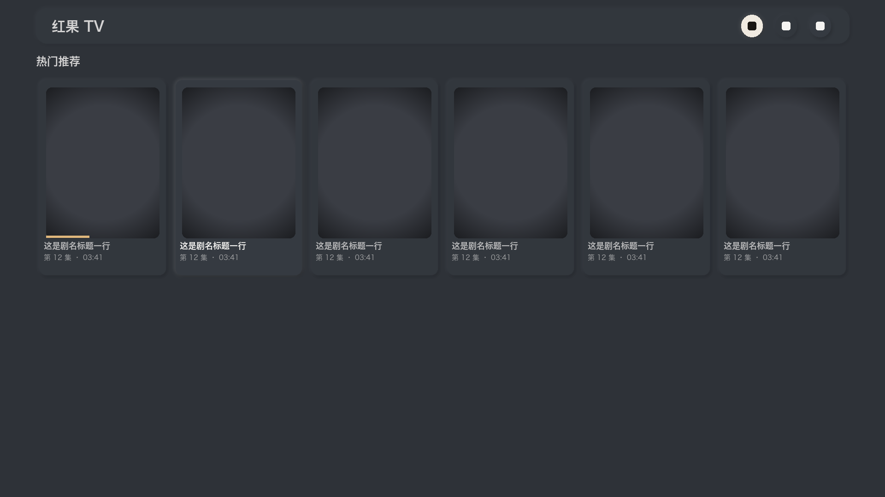

# 红果 TV（Android TV 原生版）_(hongguoTV)_

面向 Android TV 的短剧客户端：单 APK、Kotlin + Media3，装到电视上联网即用。

安装一个 APK 就能在电视上浏览、搜索和播放，不需要在电脑或 NAS 上常驻服务，也不需要填写服务器地址。
应用名「红果 TV 原生版」，包名 `com.hongguotv.nativeapp`，最低 Android 8.0（API 26），目标 API 36。
收藏、观看进度与设置只保存在本机，不上传。

## 目录

- [安全](#安全)
- [背景](#背景)
- [功能](#功能)
- [界面](#界面)
- [安装](#安装)
- [使用](#使用)
- [工程结构](#工程结构)
- [开发](#开发)
- [维护者](#维护者)
- [参与贡献](#参与贡献)
- [许可证](#许可证)

## 安全

- 仓库不含任何发布私钥、签名口令或构建产物：`release.jks`、`keystore.properties`、`local.properties` 与
  `outputs/` 下的 APK 都由 [`.gitignore`](.gitignore) 排除，签名口令只以环境变量或本机配置传入。
- 本机记录（收藏 / 进度 / 设置）只存在设备上，不上传。
- 仅在打开「手机输入」或「手机备份与恢复」窗口时，应用才临时监听局域网 HTTP，最长 5 分钟，窗口关闭或退到后台即停止。
- 遇到错误会明确显示，不会用假内容顶替。

## 背景

目标是「电视上装一个 APK 就能用」：不要额外部署服务，不要配置地址，遥控器就能完成浏览、搜索、收藏、续播与播放设置。

因此客户端做成完全独立的原生应用：界面用 Kotlin + Android 原生 View，播放用 Media3；
媒体数据由应用自己通过 HTTPS 分段拉取并在本机处理，没有 JS 引擎，也没有常驻内容服务。
封面、索引与播放缓冲都有上限，媒体只在内存中处理，不把整部剧下载到存储。

## 功能

- **浏览**：首页分区剧架、热播榜（多榜单）、分类页（大类 / 小类）。
- **搜索**：关键词搜索，结果向下自动加载；可选配置搜索口令以获得完整结果。
- **收藏与记录**：本机收藏、最近观看、稍后看，支持断点续播与「继续观看」直达。
- **选集**：详情页与播放器内同一套选集网格，按页翻看。
- **播放**：480P / 720P / 1080P 上限、0.75–2× 倍速、三种画面模式、自动连播。
- **弹幕**：全屏 / 上方 / 隐藏三档，表情标签还原成表情图，字号与透明度可调。
- **定时停止**：按分钟或按集数到点暂停并保存进度。
- **手机辅助**：扫码在手机上输入搜索词、导出或导入本机记录（局域网，用完即关）。
- **主题**：十四套材质主题，深浅都有。

## 界面

深色新拟态（Neumorphism）风格：全站只有一块材质，层次由「凸起 / 凹陷」与柔光表达；
播放界面不套新拟态，压在画面上的字与线固定暖白，避免和画面抢注意力。

离线校对图（由 `tools/` 下脚本生成，非真机截图）在 [`docs/preview/`](docs/preview/)：



## 安装

从 [Releases](https://github.com/pan8664716/hongguoTV/releases) 下载最新正式 APK，拷到电视安装，或用 ADB 覆盖安装：

```sh
adb install -r hongguotv-kotlin-0.15.2-android8.apk
```

应用内没有检查或下载更新的入口，设置 → 版本信息只读当前版本号；新版 APK 手动覆盖安装，本机收藏、进度与设置保留。

### 依赖

- Android TV 或 Android 8.0（API 26）及以上的设备。
- APK 不含 JNI 库，Android 会在 ARM32 / ARM64 / x86 / x86_64 上运行；视频解码能力取决于设备。
- 换用别的签名重建后不能覆盖安装本仓库发布密钥签名的 APK（卸载会清除本机记录）。

## 使用

在电视应用列表打开「红果 TV 原生版」，进入首页或搜索。

| 位置 | 按键 | 行为 |
| --- | --- | --- |
| 首页 | 上下 / 左右 | 切换剧架 / 选卡；行末「查看全部」进集合页 |
| 搜索 | 输入后向下 | 结果向下自动加载，滚到底部自动取下一页 |
| 详情 | 确认 | 播放 / 续播；「完整简介」「相关剧集」可展开 |
| 播放中 | 确认 | 暂停 / 播放 |
| 播放中 | 左右 | 跳转 10 秒，长按连续跳转 |
| 播放中 | 向下 | 打开选集面板 |
| 播放中 | 向上 / 菜单键 | 打开播放设置（清晰度 / 倍速 / 画面模式 / 弹幕 / 定时） |
| 播放中 | 返回 | 先关选集或收起控制条，再退出播放 |

首页剧架自上而下是「历史记录 / 我的收藏 / 热门推荐 / 热门发现」，每栏最多十部，没有记录的剧架不占位。
设置里可选默认清晰度、是否自动连播、弹幕显示方式与主题外观。

## 工程结构

```
android/                Gradle 工程根（Android Studio 直接打开这一层）
├─ app/                 电视界面、遥控器焦点、本地收藏 / 进度、弹幕绘制层、Media3 播放器
├─ core/                内容列表、搜索、详情、播放地址解析、媒体分段与弹幕解析（纯 Kotlin，可在 JVM 测试）
│  └─ src/test/         单元测试与固定向量
├─ gradle/ gradlew       Gradle 8.14.3 包装器
└─ build.gradle.kts     构建脚本与发布签名配置
docs/                   项目文档与离线校对图（preview/）
tools/                  图标 / 主题 / 界面校对脚本、静态校验脚本、构建脚本
README.md NOTICE.md LICENSE
```

## 开发

需要 JDK 17、Android SDK Platform 36 / Build Tools 36.0.0；Gradle 8.14.3 包装器已随仓库提供。
设置 `ANDROID_HOME`，或在 `android/local.properties` 写入 `sdk.dir=<SDK 绝对路径>`。

```sh
# 开发包：直接可安装，无需发布私钥
./android/gradlew -p android :core:test :app:lintDebug :app:assembleDebug
adb install -r android/app/build/outputs/apk/debug/app-debug.apk
```

静态校验与离线校对图：

```sh
python3 tools/verify-button-system.py    # 按钮系统规则（全站唯一实现、三档尺寸、令牌化内边距）
python3 tools/app-icon.py --check        # 矢量 / 位图 / 背景色与脚本是否同源
python3 tools/theme-preview.py           # 十四套主题对比度自检 → docs/preview/themes.png
python3 tools/neumorphism-preview.py     # 首页 / 按钮六态 / 强调色校对 → docs/preview/
```

正式包使用独立发布密钥，**私钥与口令不入库**。重建发布包时用环境变量，或在 `android/keystore.properties` 配置：

```properties
storeFile=/absolute/path/to/your-release.jks
storePassword=your-password
keyAlias=your-alias
keyPassword=your-password
```

对应环境变量：`HONGGUOTV_KEYSTORE`、`HONGGUOTV_STORE_PASSWORD`、`HONGGUOTV_KEY_ALIAS`、`HONGGUOTV_KEY_PASSWORD`。

```sh
./tools/build-kotlin.sh
# 输出：outputs/hongguotv-kotlin-<版本>-android8.apk
```

### 验证边界

已进行 JVM 单元测试、Android lint、正式 APK 构建，并在 Android TV API 36 模拟器上做过真实播放与遥控器检查。
最低 API 26 配置与静态检查不等同于实体电视验收：**Android 8.0 实体电视的芯片解码、音频输出与长期稳定性仍需实机验证**；
解码失败可先试 720P，仍失败需要该电视的日志。实体电视上的弹幕观感（字号、轨道密度、3 米外可读性）、
低端 GPU 帧率与长时间观看表现同样待实机验收。

## 维护者

[@pan8664716](https://github.com/pan8664716) — 仓库所有者与唯一维护者。

## 参与贡献

本项目为自用工具，不承诺接受外部 PR。

- 提问或报 bug 请开 [Issue](https://github.com/pan8664716/hongguoTV/issues)；提交代码前请先开 Issue 说明意图。
- 补丁需保持现有约定：不引入新的第三方运行时依赖，不在源码或提交里放入私钥、口令与构建产物。
- 请在提交信息里说明改动的动机与验证方式；涉及界面的改动请附上 `tools/` 下对应校验脚本的输出。

## 许可证

[GPL-3.0-only](LICENSE) © 2026 pan8664716；第三方依赖声明见 [NOTICE.md](NOTICE.md)。

本项目 fork 自 [N3urda/hongguoTV](https://github.com/N3urda/hongguoTV)。
